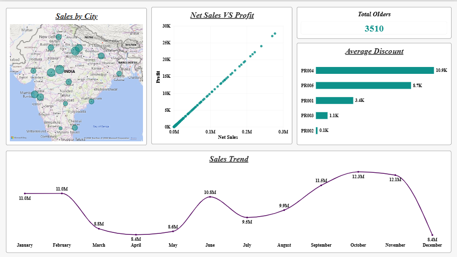
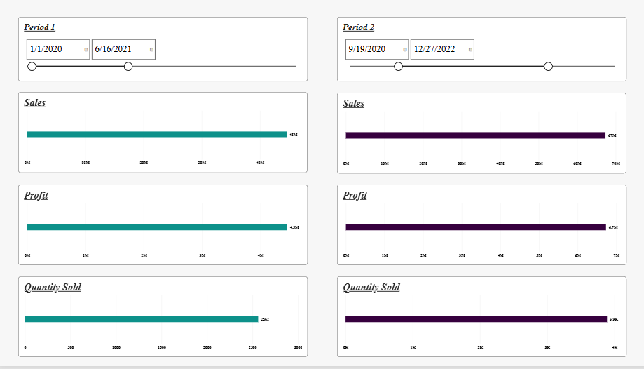
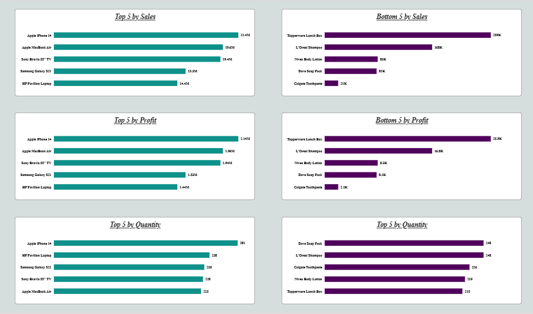

# 🛒 ElectroHub Sales Analytics Dashboard

> A multi-page Power BI report that answers eight core business questions for **ElectroHub**, a retailer selling electronics, appliances, clothing, personal care, and more. It is built on a four-table data model with extensive DAX and Power Query work.


---

## 📑 Table of Contents

- [Overview](#-overview)
- [Business Questions Answered](#-business-questions-answered)
- [Dashboard Preview](#-dashboard-preview)
- [Report Pages](#-report-pages)
- [Data Model](#-data-model)
- [DAX & Data Transformation](#-dax--data-transformation)
- [Key Insights](#-key-insights)
- [Tools & Techniques](#-tools--techniques)
- [How to Use](#-how-to-use)
- [Author](#-author)

---

## 📖 Overview

**ElectroHub** sells across eight product categories:

`Electronics` · `Footwear` · `Clothing` · `Home Appliances` · `Accessories` · `Kitchenware` · `Bags` · `Personal Care`

This project turns raw sales data into an interactive report that helps decision-makers see what sells, where it sells, how sales change over time, and how two time periods compare.

---

## ❓ Business Questions Answered

Every visual in the report maps to a requirement from the project brief:

| # | Business Question | Where to Find It |
|---|-------------------|------------------|
| 1 | Top/Bottom 5 products by Sales, Profit, and Quantity Sold | Page 3: Product Performance |
| 2 | How do sales trends vary over time? | Page 1: *Sales Trend* |
| 3 | What is the relationship between sales and profit? | Page 1: *Net Sales vs Profit* |
| 4 | Compare sales, profit, and quantity sold between two user-selected periods | Page 2: Period Comparison |
| 5 | Average discount offered in each discount category | Page 1: *Average Discount* |
| 6 | Total number of orders | Page 1: *Total Orders* card |
| 7 | Order-level details (Sales, Profit, Discount, Net Sales, etc.) filterable by Product, Date, Customer ID, and Promotion Category | Page 4: Order Details |
| 8 | Sales by city | Page 1: *Sales by City* map |

---

## 🖼 Dashboard Preview

### Page 1: Sales Overview


### Page 2: Period Comparison


### Page 3: Product Performance (Top & Bottom 5)



---

## 📄 Report Pages

### 1️⃣ Sales Overview
- **Sales by City**: bubble map showing where sales are concentrated
- **Net Sales vs Profit**: scatter plot showing how profit scales with net sales
- **Total Orders**: KPI card (3,510 orders)
- **Average Discount**: bar chart by discount category (PR001 to PR005)
- **Sales Trend**: monthly sales line chart with data labels

### 2️⃣ Period Comparison
Two independent date selectors, **Period 1** and **Period 2**, let the user pick any two date ranges. Sales, Profit, and Quantity Sold are shown side by side for each period, in separate colors, so they can be compared at a glance.

### 3️⃣ Product Performance
Six ranked bar charts, with the best performers on the left and the weakest on the right:

| Metric | Top 5 | Bottom 5 |
|--------|:-----:|:--------:|
| Sales | ✅ | ✅ |
| Profit | ✅ | ✅ |
| Quantity Sold | ✅ | ✅ |

### 4️⃣ Order Details
<!-- Describe the order-level table and its visual filters (Product, Date, Customer ID, Promotion Category). -->

---

## 🧩 Data Model

The report is built on a **four-table data model**. Relationships were designed so that every slicer and visual filters correctly across tables.

| Table | Type | Description |
|-------|------|-------------|
| `<Table 1>` | Fact | <e.g., order lines with sales, profit, discount, quantity> |
| `<Table 2>` | Dimension | <e.g., products and categories> |
| `<Table 3>` | Dimension | <e.g., customers and cities> |
| `<Table 4>` | Dimension | <e.g., date / calendar> |

<!-- Add a screenshot of Model View:  -->

---

## 🧮 DAX & Data Transformation

A large part of this project is the calculation and preparation work behind the visuals.

**Data transformation (Power Query)**
- Extensive cleaning and shaping of the source tables before modelling
- <add specifics, e.g., fixing data types, handling nulls, splitting or merging columns, standardising city names>

**DAX**
- **Calculated columns**: derived fields used for grouping, categorisation, and filtering
- **Conditional columns**: rule-based categories such as discount groups
- **Measures**: Sales, Profit, Net Sales, Quantity Sold, Total Orders, Average Discount, and period-based measures that respond to the two independent date selectors

<!-- Paste your best DAX here:
```DAX
Total Orders = DISTINCTCOUNT(Orders[OrderID])
```
-->

---

## 💡 Key Insights

- **Sales are seasonal.** Sales peak in **October (12.3M)** and **November (12.1M)** and are lowest in **April and December (8.4M each)**. The drop from November to December is the sharpest fall in the year.
- **Electronics dominate revenue.** The top five products by sales are all electronics: iPhone 14 (21.4M), MacBook Air (19.6M), Sony Bravia 55" TV (19.4M), Samsung Galaxy S23 (15.3M), and HP Pavilion Laptop (14.4M).
- **The gap between best and worst sellers is huge.** The lowest-selling product, Colgate Toothpaste (21K), earns roughly a thousandth of the top product's sales.
- **Profit follows sales closely.** The scatter plot shows an almost perfectly linear relationship. For example, iPhone 14 has 21.4M in sales and 2.14M in profit, about a 10% margin.
- **Discounting varies a lot by category.** PR004 has the highest average discount (10.9K) and PR002 the lowest (0.1K).
- **ElectroHub processed 3,510 orders** in total.

---

## 🛠 Tools & Techniques

- **Power BI Desktop**: report design and data modelling
- **DAX**: calculated columns, conditional columns, and measures
- **Power Query**: data cleaning and transformation
- **Data modelling**: four related tables
- **Visuals used**: bubble map, scatter plot, line chart, bar charts, KPI cards, date range slicers


## ▶️ How to Use

1. Clone the repository
```bash
   git clone https://github.com/<your-username>/<your-repo>.git
```
2. Install [Power BI Desktop](https://powerbi.microsoft.com/desktop/) (free, Windows only).
3. Open `ElectroHub_Report.pbix`.
4. Use the **Period 1** and **Period 2** sliders on Page 2 to compare any two date ranges.
5. Use the visual filters on the Order Details page to drill into individual orders.

---

## 👤 Author

**Sunday Theophilus Oyelami**
GitHub: [@ST-Oyelami](https://github.com/ST-Oyelami)

---

⭐ If you found this project useful, please consider giving it a star.
